# Курсовой проект

# Мониторинг давления рубашки реактора

## Вариант 35

Программа рассчитывает индикатор процесса `Q` по показаниям датчика давления `X`
в рубашке реактора и определяет состояние процесса: **норма** или **превышение
верхней границы** `UCL`.

---

## Входные данные

| Параметр | Значение |
|---|---|
| Имя переменной | `X` |
| Тип | `double` |
| Единицы измерения | бар |
| Физический смысл | показание датчика давления рубашки реактора |
| Допустимый диапазон | `X ∈ [1; 8]` бар |
| Количество измерений | 40 |

Если введённое значение выходит за пределы `[1; 8]`, выводится сообщение об
ошибке, и значение не учитывается.

---

## Выходные данные

| Параметр | Значение |
|---|---|
| Имя переменной | `Q` |
| Тип | `double` |
| Физический смысл | индикатор процесса |
| Верхняя граница `UCL` | `63.83` |
| `state = 0` | `Q ≤ UCL` — норма |
| `state = 1` | `Q > UCL` — превышение |

---

## Формула Q = f(X)

## Ручной расчёт Q для контрольных значений X

| X, бар | Ветвь формулы | Расчёт | Q | state |
|---|---|---|---|---|
| `1.5` | `X < 2.0` | `3·(1.5 − 2) + 10 = 3·(−0.5) + 10 = 8.5` | `8.50` | `0` (норма) |
| `3.5` | `2.0 ≤ X ≤ 5.0` | `2·√(3.5 − 1.5) + 45 = 2·√2 + 45 ≈ 2·1.4142 + 45 ≈ 47.83` | `≈ 47.83` | `0` (норма) |
| `5.0` | `2.0 ≤ X ≤ 5.0` | `2·√(5.0 − 1.5) + 45 = 2·√3.5 + 45 ≈ 2·1.8708 + 45 ≈ 48.74` | `≈ 48.74` | `0` (норма) |
| `7.0` | `X > 5.0` | `(7 − 5)² + 55 = 4 + 55 = 59` | `59.00` | `0` (норма) |
| `8.0` | `X > 5.0` | `(8 − 5)² + 55 = 9 + 55 = 64` | `64.00` | `1` (превышение) |

---

## Блок-схема преобразования данных

Цепочка преобразования: **X → f(X) → Q → CONTROL → STATE**

;
   - `double Q` — рассчитанный индикатор процесса;
   - `int state` — состояние (`0` — норма, `1` — превышение);
   - `int i` — счётчик цикла (от 1 до 40).
3. Цикл `for` от `1` до `N = 40`:
   - запросить у пользователя значение `x` (`scanf("%lf", &x)`);
   - если ввод некорректен (введён не числовой символ) — вывести
     `НЕИЗВЕСТНЫЙ СИМВОЛ`, очистить буфер ввода и повторить итерацию;
   - проверить, находится ли `x` в допустимом диапазоне `[1; 8]`;
     если нет — вывести `Ошибка: показание вне диапазона [1...8] бар.`
     и перейти к следующей итерации;
   - если значение в диапазоне — рассчитать `Q` по одной из трёх формул
     в зависимости от значения `x`;
   - сравнить `Q` с верхней границей `UCL = 63.83`:
     - если `Q > UCL`, установить `state = 1` (ПРЕВЫШЕНО);
     - иначе установить `state = 0` (НОРМА);
   - вывести на экран значения `x`, `Q` и текущее состояние.
4. После завершения цикла вывести сообщение `ОБРАБОТКА ЗАВЕРШЕНА`.
5. **Конец.**

---

## Структура программы

| Функция | Назначение |
|---|---|
| `double calc_q(double x)` | расчёт индикатора `Q` по значению `X` |
| `int proverca_Q(double Q)` | контроль: `1` — превышение `UCL`, `0` — норма |
| `void print_result(double x, double Q, int state)` | вывод результата одного измерения |
| `int main(void)` | пользовательский интерфейс, ввод и цикл по 40 измерениям |

Прототипы функций объявлены перед `main`, определения — после него.
